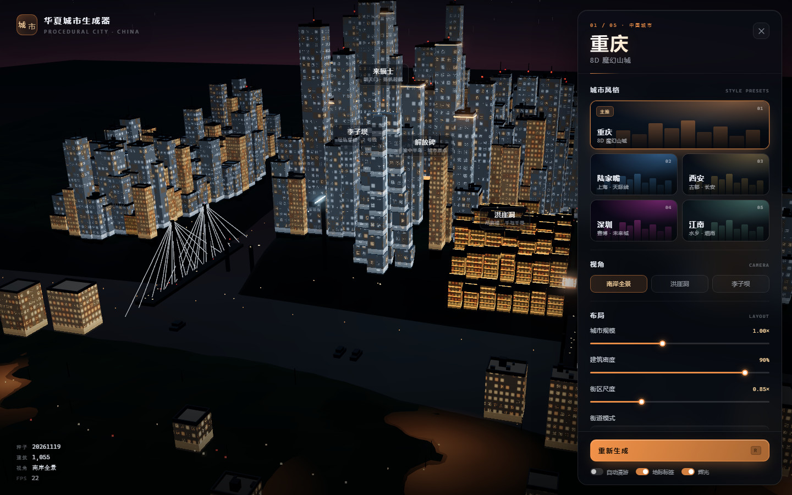
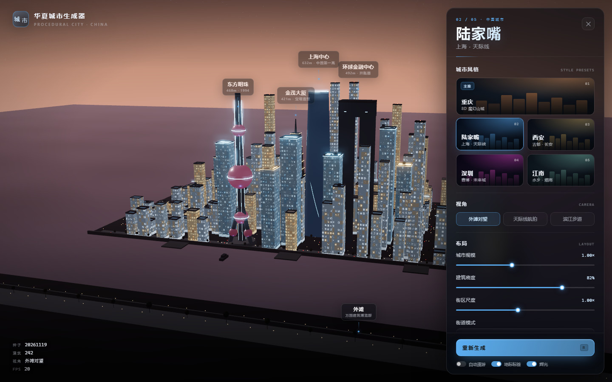
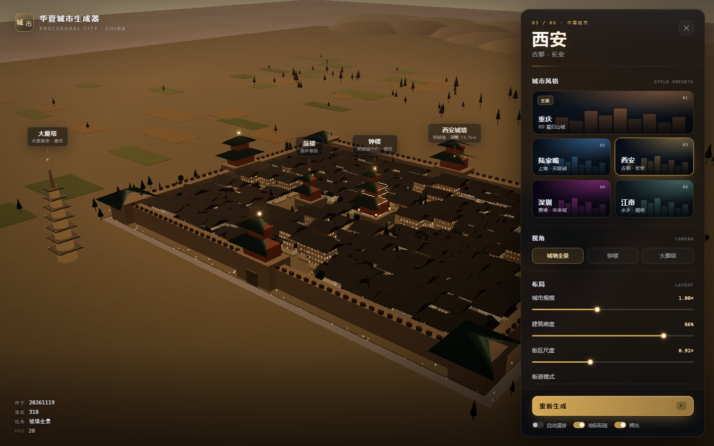
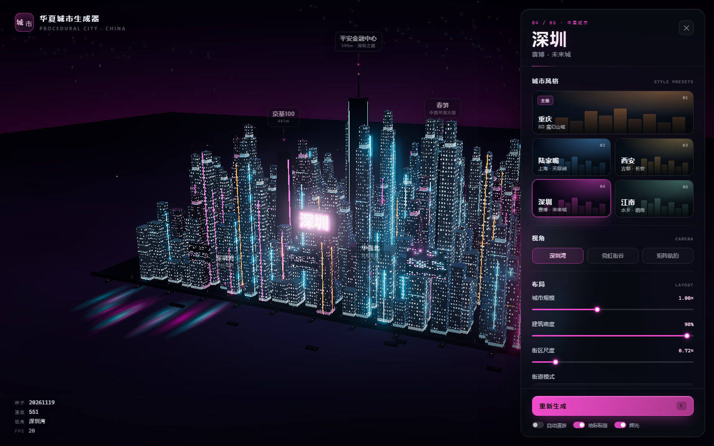
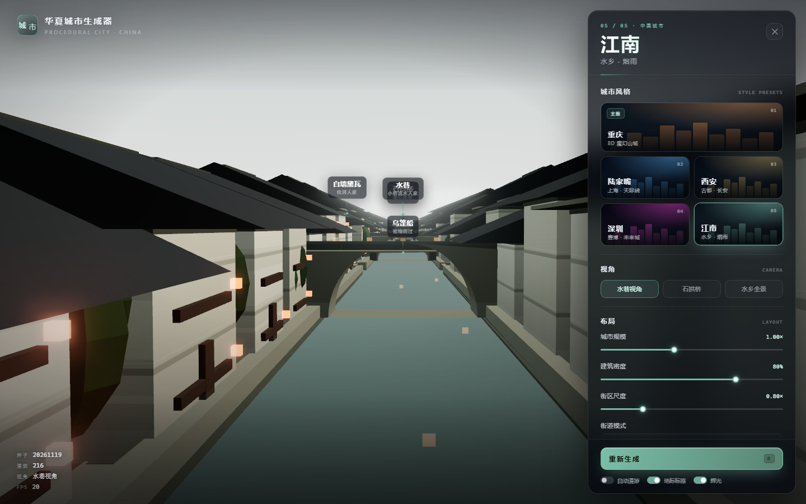

# 华夏城市生成器 · Procedural City CN

浏览器里的程序化 3D 中国城市生成器。五种中国城市风格，全部由代码实时生成：没有模型文件、没有烘焙贴图，也没有构建步骤。

> 灵感来自 OpenAI Showcase 的 Procedural City Generator，致敬其「全屏城市 + 右侧参数面板 + 实时重生成」的交互；本项目为中国城市重新设计地形、建筑类型、地标、色调与氛围。与 OpenAI 无隶属关系。



| 陆家嘴 | 西安 |
| --- | --- |
|  |  |
| **赛博深圳** | **江南水乡** |
|  |  |

## 五种城市

- **重庆 · 8D 魔幻山城**（重点）：两江交汇的半岛地形、依山而建的密集楼群与挡土墙、黄桷湾式多层叠环立交、李子坝轻轨穿楼（列车实时光影运动）、洪崖洞吊脚楼群与暖色灯带、来福士扬帆塔、解放碑、跨江斜拉桥。
- **上海陆家嘴**：东方明珠、上海中心扭转塔、环球金融中心「开瓶器」、金茂大厦塔式退台，黄浦江、外滩与江上游船。
- **古都西安**：明城墙与城门楼、钟楼、鼓楼、大雁塔、棋盘里坊、护城河、灯笼暖光与秦岭远山。
- **赛博深圳**：平安金融中心、春笋、京基 100，霓虹立面、LED 巨幕、空中连廊、磁浮列车、飞行器光点与深圳湾夜色。
- **江南水乡**：水巷棋盘、石拱桥、乌篷船、白墙黛瓦、垂柳、七层古塔与烟雨薄雾。

每种风格拥有独立的地形、建筑形态、天际线、灯光、雾气和默认相机，切换时带有电影感转场。

## 编辑器

右侧浮层面板实时驱动生成，修改参数约 100ms 后自动重建：

- **城市风格**：五种预设，以及每种风格对应的街道模式
- **布局**：城市规模、建筑密度、街区尺度
- **天际线**：平均高度、高度差异
- **功能分区**：商业办公 / 住宅社区 / 工业仓储配比
- **环境**：水域范围、公园绿地、地形起伏、时间光线、雾气浓度
- **生成**：种子输入、随机种子、重新生成
- **视角**：每种城市 3 个电影机位
- **开关**：地标标签、自动漫游、辉光

快捷键：`1–5` 切换城市，`R` 重新生成，`空格` 自动漫游。参数会写入 URL hash，复制链接即可复现同一座城市。

## 运行

纯静态站点，无构建步骤：

```powershell
# 方式一：使用内置静态服务器
npm start
# http://127.0.0.1:5173/

# 方式二：任意静态服务器
python -m http.server 5173
```

需要支持 WebGL2 的现代浏览器（Chrome / Edge / Firefox / Safari 新版本）。Three.js 与后期处理模块已 vendored 到 `vendor/`，运行时不依赖 CDN。

## 测试

```powershell
npm install
npm test
```

`npm test` 会用 Playwright 启动无头 Chromium，完成：

- 逐个切换五种风格并截图（输出到 `docs/screenshots/final/`）
- 检查画面非空、五城两两视觉差异、地标标签、建筑数量
- 调整密度滑杆，验证实时重建与画面变化
- 调整时间光线，验证昼夜差异
- 验证视角切换、种子可复现、无控制台错误

视觉回归依赖无头 Chromium 的 SwiftShader 软件渲染，所以测试启动较慢，但不需要真实 GPU。

## 实现

| 文件 | 内容 |
| --- | --- |
| `js/main.js` | 渲染循环、相机、后期、UI 绑定、状态与 URL |
| `js/environment.js` | 天空渐变、太阳/月亮、雾、水面 shader、昼夜调色 |
| `js/context.js` | 生成上下文、InstancedMesh 批次、树木/路灯/车流/标签 |
| `js/materials.js` | 程序化窗格立面材质、霓虹/LED/玻璃材质 |
| `js/terrain.js` | 高度场地形、河流距离、顶点着色 |
| `js/geom.js` | 道路 ribbon、坡屋顶、拱桥、扭转塔、文字贴图 |
| `js/styles/*.js` | 五种城市的布局、地标与氛围 |
| `js/traffic.js` | 沿道路移动的车灯粒子 |
| `tests/smoke.mjs` | Playwright 功能与像素差异测试 |

技术要点：

- **单 draw call 建筑群**：`InstancedMesh` + `onBeforeCompile` 立面 shader，按实例随机亮窗，数以千计的楼宇保持流畅。
- **近景建筑细节**：立面 shader 增加窗框、竖梃、楼层分隔线与檐口；屋顶统一生成女儿墙、楼梯间、水箱与空调机组，近处可分辨楼层、窗格和屋顶结构。
- **远景 LOD 与顺滑轮廓**：窗格等高频细节随距离渐隐、远窗发光取平均，避免远景闪烁；重庆地形网格加密到 300 段并衰减远处高频起伏，后期渲染开启 4× MSAA，远景轮廓和地表更顺滑。
- **程序化地形**：重庆用噪声高度场 + 两江折线距离场切出河床与陡岸，建筑自动生成挡土墙/吊脚基础。
- **有生命的细节**：车灯光点、轻轨列车、乌篷船、磁浮、飞行器、江面反光、LED 屏幕动画。
- **可复现**：种子 + 参数决定全部随机数，URL hash 同步。

## 截图

最终效果见 [`docs/screenshots/final/`](docs/screenshots/final/)。每张图中右侧面板展示了该城市的默认参数与机位。

近景细节与远景轮廓的 Before / After 对照见 [`docs/screenshots/detail-lod/`](docs/screenshots/detail-lod/)，可用 `npm run capture:detail` 重新采集。

## 许可

代码以 MIT 许可发布。Three.js 版权归其作者，MIT 许可。
